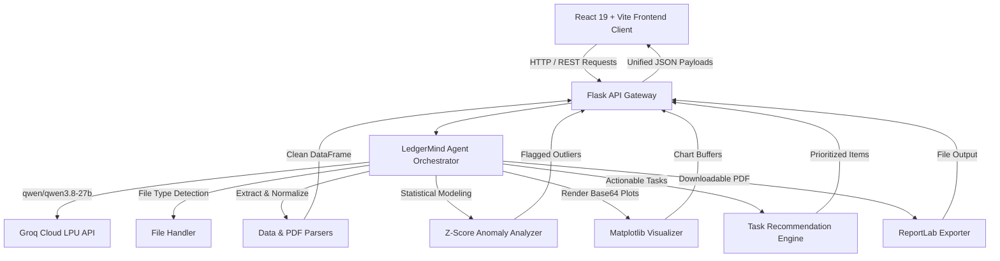

# 🧠 LedgerMind AI — Autonomous Financial Intelligence Platform

<div align="center">

[](https://ledger-mind-ai.vercel.app/)
[](https://ledger-mind-ai-backend.vercel.app/api/health)
[](https://groq.com/)

[](https://www.python.org/)
[](https://flask.palletsprojects.com/)
[](https://reactjs.org/)
[](https://vitejs.dev/)
[](LICENSE)

**An enterprise-grade, autonomous financial intelligence platform engineered for businesses, startups, and analysts.**  
Powered by **Groq LPU Acceleration** (`qwen/qwen3.8-27b`) for sub-second financial reasoning, statistical anomaly detection, dynamic data visualizer, and publication-ready audit reports.

[Live Application](https://ledger-mind-ai.vercel.app/) • [API Health](https://ledger-mind-ai-backend.vercel.app/api/health) • [Report Bug](https://github.com/InsaSaleem/LedgerMind-AI/issues) • [Request Feature](https://github.com/InsaSaleem/LedgerMind-AI/issues)

</div>

---

## 📌 Table of Contents
- [Executive Overview](#-executive-overview)
- [Key Features](#-key-features)
- [System Architecture](#-system-architecture)
- [Project Structure](#-project-structure)
- [Step-by-Step Local Setup Guide](#-step-by-step-local-setup-guide)
  - [Prerequisites](#prerequisites)
  - [1. Clone the Repository](#1-clone-the-repository)
  - [2. Backend Setup](#2-backend-setup)
  - [3. Configure Environment Variables](#3-configure-environment-variables)
  - [4. Frontend Setup](#4-frontend-setup)
  - [5. Run the Project Locally](#5-run-the-project-locally)
- [Production Deployment (Vercel)](#-production-deployment-vercel)
- [API Reference](#-api-reference)
- [Access URLs Summary (Local & Live)](#-access-urls-summary)
- [License & Author](#-license--author)

---

## 📌 Executive Overview

Traditional accounting software requires manual entry, complex pivot tables, and steep learning curves. **LedgerMind AI** turns raw financial documents into actionable business intelligence within seconds.

By leveraging **Groq LPU hardware acceleration** and modular analytical tools, LedgerMind AI:
1. Ingests raw bank statements (PDF, CSV, Excel, scanned receipt images).
2. Runs statistical **Z-Score anomaly detection** to flag unusual spending or duplicate charges.
3. Provides an **agentic financial conversational interface** with real-time reasoning narration.
4. Generates **prioritized action items** to reduce overhead and improve cash flow.
5. Produces polished, executive **PDF audit reports** with embedded charts.

---

## 🚀 Key Features

- **⚡ Blazing-Fast AI Financial Analyst**: Low-latency queries powered by Groq (`qwen/qwen3.8-27b`) with automatic tag stripping and formatted agent reasoning narration.
- **📄 Multi-Format Document Ingestion**:
  - **CSV & Excel**: Heuristic column normalization (`Date`, `Description`, `Amount`, `Category`).
  - **PDF Statements**: Native digital table extraction via `pdfplumber`.
  - **Images & Receipts**: Vision parsing with OCR fallback for scanned invoices.
- **🚨 Automated Fraud & Anomaly Engine**: Statistical Z-score modeling flags high-variance spending spikes, unusual recurring charges, and anomalies.
- **📊 Embedded Data Visualizations**: Generates dark-themed Matplotlib category breakdown pie charts, monthly spending trend lines, and comparative bar graphs.
- **📋 Smart Financial Task Engine**: AI automatically categorizes and prioritizes financial recommendations into *Investigate*, *Optimize*, *Review*, and *Budget*.
- **📑 Executive PDF Report Generator**: One-click compilation of total spend, categorical distribution, charts, and flagged anomalies into a downloadable report.

---

## 🏗️ System Architecture



---

## 🛠️ Project Structure

```text
LedgerMind-AI/
├── backend/
│   ├── agent/
│   │   ├── __init__.py
│   │   └── orchestrator.py        # Core Groq agent & workflow orchestrator
│   ├── api/
│   │   └── index.py               # Vercel Serverless Function entry point
│   ├── tools/
│   │   ├── analyzer.py            # Z-Score statistical anomaly detection
│   │   ├── data_parser.py         # CSV & Excel normalization engine
│   │   ├── file_handler.py        # Multi-format mime & extension validation
│   │   ├── image_parser.py        # Groq Vision & OCR receipt parser
│   │   ├── pdf_parser.py          # PDF table extractor via pdfplumber
│   │   ├── report_generator.py    # Executive PDF generator (ReportLab)
│   │   ├── task_generator.py      # AI task recommendation engine
│   │   └── visualizer.py          # Matplotlib chart generator
│   ├── uploads/                   # Stored statements & sample files
│   ├── .env.example               # Template for environment variables
│   ├── app.py                     # Flask application & API routes
│   ├── requirements.txt           # Python backend dependencies
│   └── vercel.json                # Vercel serverless configuration
├── frontend/
│   ├── public/                    # Favicons & static assets
│   ├── src/
│   │   ├── components/
│   │   │   ├── Chat.jsx           # Conversational agent interface with charts
│   │   │   ├── Dashboard.jsx      # Glassmorphic summary & anomaly metrics
│   │   │   ├── Tasks.jsx          # Prioritized task manager
│   │   │   └── Uploader.jsx       # Drag-and-drop document upload zone
│   │   ├── App.jsx                # Main single-page application layout
│   │   ├── index.css              # Global styles & design system
│   │   └── main.jsx               # React DOM entry point
│   ├── package.json               # Frontend dependencies & scripts
│   ├── vercel.json                # Frontend Vercel rewrite configuration
│   └── vite.config.js             # Vite build & reverse-proxy config
├── docs/                          # Built production distribution
├── README.md                      # Comprehensive project documentation
└── .gitignore                     # Git ignore rules
```

---

## ⚡ Step-by-Step Local Setup Guide

Follow these exact steps to run LedgerMind AI on your local machine.

### Prerequisites
Make sure you have the following installed:
- **Python**: Version `3.9` or higher ([Download Python](https://www.python.org/downloads/))
- **Node.js**: Version `18.x` or higher ([Download Node.js](https://nodejs.org/))
- **Git**: Installed and configured ([Download Git](https://git-scm.com/))
- **Groq API Key**: Free API key from [Groq Console](https://console.groq.com/keys)

---

### 1. Clone the Repository

Open your terminal or PowerShell and run:

```bash
git clone https://github.com/InsaSaleem/LedgerMind-AI.git
cd LedgerMind-AI
```

---

### 2. Backend Setup

Set up a dedicated Python virtual environment and install the required dependencies:

```bash
# 1. Navigate into the backend directory
cd backend

# 2. Create a virtual environment
python -m venv venv

# 3. Activate the virtual environment:
# On Windows (PowerShell / CMD):
.\venv\Scripts\activate
# On macOS / Linux:
# source venv/bin/activate

# 4. Install backend dependencies
pip install -r requirements.txt
```

---

### 3. Configure Environment Variables

Create your `.env` file inside the `backend/` directory:

```bash
# On Windows (PowerShell):
Copy-Item .env.example .env
# On macOS / Linux:
# cp .env.example .env
```

Open `backend/.env` in your code editor and insert your Groq API key:

```env
GROQ_API_KEY=gsk_your_groq_api_key_here
FLASK_ENV=development
PORT=5000
```

---

### 4. Frontend Setup

In a new terminal window, install the frontend packages:

```bash
# 1. Navigate into the frontend directory
cd frontend

# 2. Install Node dependencies
npm install
```

---

### 5. Run the Project Locally

You have **two convenient options** to run the application:

#### 🌟 Option A: Unified Single-Port Mode (Recommended)
This runs **both the Frontend and Backend on ONE single URL** (`http://localhost:5000`):

1. Build the React frontend into static assets:
   ```bash
   cd frontend
   npm run build
   ```
2. Start the Flask server:
   ```bash
   cd ../backend
   python app.py
   ```
3. Open your browser at:  
   👉 **`http://localhost:5000`**  
   *(Flask seamlessly serves the complete React UI and handles all `/api/*` endpoints!)*

---

#### ⚡ Option B: Full Development Mode (With Hot-Reload)
This runs both servers with instant hot-reloading for frontend developers:

1. **Terminal 1 — Start the Backend:**
   ```bash
   cd backend
   .\venv\Scripts\activate   # (or source venv/bin/activate on macOS/Linux)
   python app.py
   ```
   *Backend runs at:* `http://127.0.0.1:5000`

2. **Terminal 2 — Start the Frontend:**
   ```bash
   cd frontend
   npm run dev
   ```
   *Frontend runs at:* `http://localhost:5173`

> [!NOTE]
> Vite automatically proxies all `/api/*` calls from `http://localhost:5173` to `http://127.0.0.1:5000`, so all features work seamlessly out of the box!

---

## 🌐 Production Deployment (Vercel)

This project is pre-configured with modern Vercel Serverless Function specifications.

### 1. Backend Project
1. Import the repository in [Vercel Dashboard](https://vercel.com/dashboard).
2. Set **Root Directory** to `backend`.
3. Set **Framework Preset** to `Other`.
4. Add Environment Variable:
   - `GROQ_API_KEY`: `gsk_...`
5. Deploy. (Live URL: `https://ledger-mind-ai-backend.vercel.app`)

### 2. Frontend Project
1. Import the same repository as a new project in Vercel.
2. Set **Root Directory** to `frontend`.
3. Set **Framework Preset** to `Vite`.
4. Build Command: `npm run build`, Output Directory: `dist`.
5. Deploy. (Live URL: `https://ledger-mind-ai.vercel.app`)

---

## 📡 API Reference

All endpoints accept and return JSON payloads (or multipart for uploads):

| Method | Endpoint | Description |
| :--- | :--- | :--- |
| `GET` | `/api/health` | Health check, AI provider status & active model |
| `POST` | `/api/upload` | Multipart file upload (CSV, XLSX, PDF, PNG, JPG) & anomaly detection |
| `POST` | `/api/chat` | Natural language query with reasoning narration & chart generation |
| `GET` | `/api/dashboard` | Aggregated spend, top categories, and flagged anomalies |
| `GET` | `/api/tasks` | AI-generated categorized and prioritized action items |
| `POST` | `/api/export` | Generates a downloadable executive audit PDF report |
| `GET` | `/api/download/<file>` | Downloads generated PDF reports or export assets |

---

## 🔗 Access URLs Summary

### 💻 Local Environment

| Service | URL | Notes |
| :--- | :--- | :--- |
| **Unified Full-Stack (Recommended)** | **[http://localhost:5000](http://localhost:5000)** | Single URL for both Frontend UI & Backend APIs |
| **Frontend Dev Server** | **[http://localhost:5173](http://localhost:5173)** | Vite development server with HMR & API proxy |
| **Backend API Gateway** | **[http://127.0.0.1:5000](http://127.0.0.1:5000)** | Flask REST API & Groq Agent endpoints |
| **Backend Health Check** | **[http://127.0.0.1:5000/api/health](http://127.0.0.1:5000/api/health)** | Validates active status and Groq key |

---

### ☁️ Live Production Environment

| Service | URL | Status |
| :--- | :--- | :---: |
| **Production Web App** | **[https://ledger-mind-ai.vercel.app](https://ledger-mind-ai.vercel.app)** | 🟢 Active |
| **Production Backend API** | **[https://ledger-mind-ai-backend.vercel.app](https://ledger-mind-ai-backend.vercel.app)** | 🟢 Active |
| **Production Health Check** | **[https://ledger-mind-ai-backend.vercel.app/api/health](https://ledger-mind-ai-backend.vercel.app/api/health)** | 🟢 Active |

---

## 📄 License & Author

- **Author**: [Insa Saleem](https://github.com/InsaSaleem)
- **License**: Distributed under the **MIT License**. See `LICENSE` for more information.
- **Repository**: [github.com/InsaSaleem/LedgerMind-AI](https://github.com/InsaSaleem/LedgerMind-AI)

<div align="center">
⭐ If you found LedgerMind AI helpful, please consider starring the repository!
</div>
