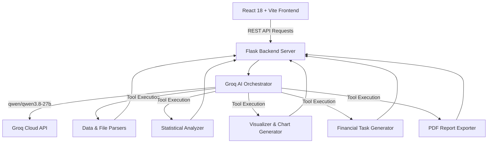

# 🧠 LedgerMind AI — Autonomous Financial Intelligence

[](https://www.python.org/)
[](https://flask.palletsprojects.com/)
[](https://reactjs.org/)
[](https://vitejs.dev/)
[](https://groq.com/)

---

## 📌 Overview

**LedgerMind AI** is an autonomous financial intelligence platform engineered for small businesses, startups, and freelancers. Operating far beyond traditional chatbots, LedgerMind AI leverages **Groq LPU Acceleration** and advanced LLMs (`qwen/qwen3.8-27b`) to orchestrate agentic workflows — seamlessly ingesting financial data, parsing complex bank statements, performing statistical anomaly detection, generating smart action items, and producing exportable executive PDF reports.

---

## 🚀 Key Features

- **⚡ Blazing Fast AI Chat & Analysis**: Powered by Groq's low-latency API (`qwen/qwen3.8-27b`), delivering instantaneous financial answers.
- **📄 Multi-Format Document Processing**: Parse raw CSVs, multi-sheet Excel files, and structured PDF bank statements (with Tesseract OCR fallback for scanned receipts).
- **🚨 Automated Anomaly & Fraud Detection**: Statistical outlier detection (Z-score analysis) flags unusual spending spikes, duplicate charges, or suspicious transactions.
- **📊 Dynamic Data Visualizations**: Real-time rendering of expense breakdowns, categorical charts, and trend line plots directly within the conversation.
- **📋 Smart Financial Task Generation**: AI analyzes spending patterns to auto-generate prioritized, actionable financial tasks and recommendations.
- **📑 Executive PDF Export**: One-click generation of polished, publication-ready financial audit reports.

---

## 🏗️ System Architecture

LedgerMind AI follows a clean, modular agentic architecture separating UI, server orchestration, AI inference, and analytical tools.



---

## 🛠️ Project Structure & Component Overview

### ⚙️ Backend Services (`backend/`)
- **`app.py`**: Flask REST API gateway providing endpoints for `/api/upload`, `/api/chat`, `/api/dashboard`, `/api/export`, and `/api/health`.
- **`agent/orchestrator.py`**: Core intelligence coordinator. Interfaces with the Groq API, manages conversational context caching, formats prompt tokens efficiently, and delegates requests to specific tools.
- **`tools/file_handler.py`**: Ingestion layer for safe file validation, extension detection, and temporary storage.
- **`tools/data_parser.py`**: Standardizes non-uniform CSV and Excel exports into a clean, unified Pandas DataFrame schema.
- **`tools/pdf_parser.py`**: Extracts tabular transaction data from native digital PDF statements using `pdfplumber`.
- **`tools/image_parser.py`**: Handles OCR and vision-based document parsing for image bank receipts.
- **`tools/analyzer.py`**: Runs Z-score statistical models to identify financial anomalies and spending outliers.
- **`tools/visualizer.py`**: Converts Pandas aggregations into Matplotlib charts and returns base64-encoded image payloads.
- **`tools/task_generator.py`**: Uses Groq AI to evaluate spending patterns and generate categorized, prioritized action items.
- **`tools/report_generator.py`**: Compiles session statistics, charts, and flagged anomalies into downloadable PDF reports.

### 💻 Frontend Client (`frontend/`)
- **`src/components/Dashboard.jsx`**: Glassmorphic financial dashboard displaying total spend, category breakdowns, and anomaly list cards.
- **`src/components/Chat.jsx`**: Real-time interactive chat interface with step-by-step agent reasoning narration and embedded charts.
- **`src/components/Uploader.jsx`**: Drag-and-drop file uploader supporting CSV, XLSX, XLS, PDF, and PNG formats.
- **`src/components/Tasks.jsx`**: Priority-based task manager showing AI-recommended financial action items.

---

## ⚡ Quick Start Guide

### Prerequisites
- **Python**: `3.9` or higher
- **Node.js**: `18.x` or higher
- **Groq API Key**: Obtain a free API key from [Groq Console](https://console.groq.com/)

---

### 1️⃣ Backend Setup

```bash
# Navigate to backend directory
cd backend

# Create and activate virtual environment
python -m venv venv

# On Windows:
venv\Scripts\activate
# On macOS/Linux:
# source venv/bin/activate

# Install dependencies
pip install -r requirements.txt

# Create .env configuration file
echo GROQ_API_KEY=gsk_your_groq_api_key_here > .env

# Run the Flask backend server
python app.py
```
*Backend server will start at:* `http://localhost:5000`

---

### 2️⃣ Frontend Setup

```bash
# Navigate to frontend directory
cd frontend

# Install Node dependencies
npm install

# Start Vite development server
npm run dev
```
*Frontend app will start at:* `http://localhost:5173`

---

## 🔑 Environment Configuration

Create a `.env` file inside the `backend/` directory:

```env
GROQ_API_KEY=gsk_your_groq_api_key_here
FLASK_ENV=development
PORT=5000
```

---

## 🌐 Production Deployment Readiness

LedgerMind AI is production-ready for deployment to platforms such as **Vercel / Netlify** (Frontend) and **Render / Railway / AWS EC2** (Backend).

### Recommended Production Command (Gunicorn WSGI):
```bash
cd backend
gunicorn --bind 0.0.0.0:5000 app:app
```

---

## 📄 License
This project is open-source under the MIT License.
